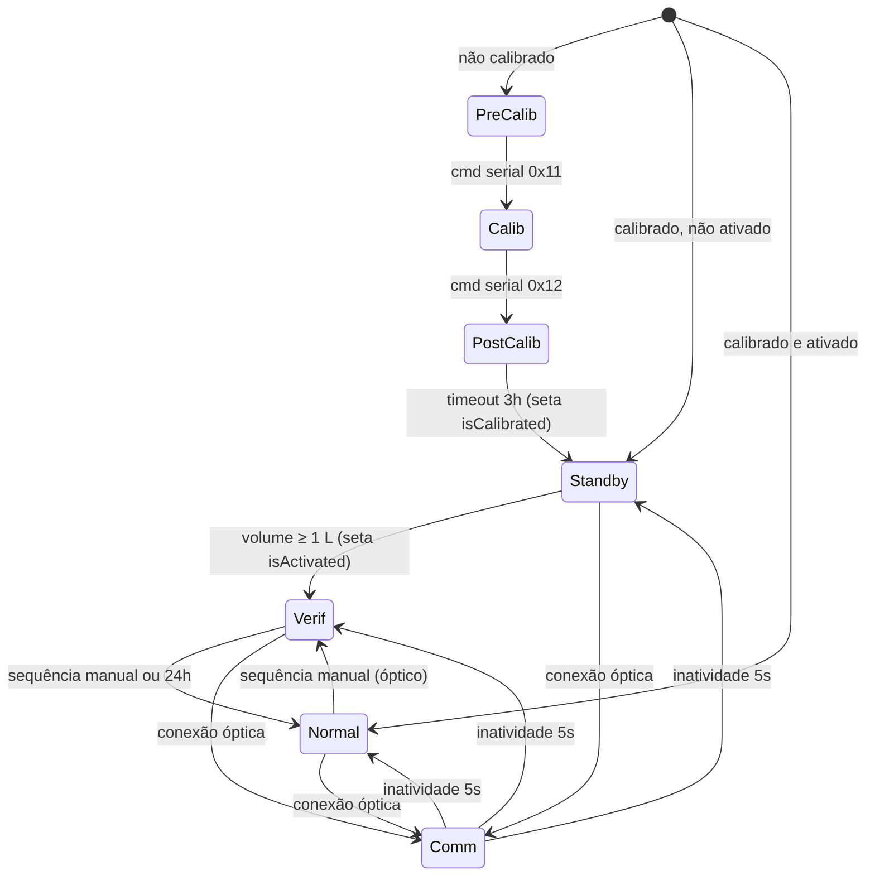

# Firmware FCX — Medidor Ultrassônico de Água

Firmware do medidor de água ultrassônico **FCX** da FAE Sistemas de Medição, executado no microcontrolador **TI MSP430FR6047** (MCU com front-end ultrassônico integrado — módulos SAPH/SDHS/HSPLL/UUPS — e FRAM).

O medidor mede o tempo de trânsito de pulsos ultrassônicos a favor e contra o escoamento, calcula vazão, volume e temperatura da água, exibe os valores em LCD, gera saída de pulsos, registra histórico (logger) e se comunica via porta óptica e serial.

- **Versão do firmware:** `3.1.1` (+ build), definida em [configmng.h](../bl/managers/headers/configmng.h)
- **Versão de hardware esperada:** `2`
- **IDE / toolchain:** Code Composer Studio (TI ARM/MSP430 compiler, EABI, large code / large data)
- **Linker script:** [lnk_msp430fr6047.cmd](../lnk_msp430fr6047.cmd)

---

## 1. Estrutura de pastas

```
fae_fcx/
├── main.c                 # Ponto de entrada: inicialização + super-loop
├── system_pre_init.c      # Executado antes do init do C runtime
├── lnk_msp430fr6047.cmd   # Mapa de memória / linker
├── defs/                  # general_settings.h — flags de build e debug
├── bl/                    # Business Logic (camada de aplicação)
│   ├── managers/          # Gerenciadores (modos, comandos, config, telas, alarmes, pulsos)
│   ├── opmodes/           # Modos de operação (precalib, calib, postcalib, standby, normal, verif, comm)
│   ├── alarms/            # Detectores de alarme (vazamento, bateria, temperatura...)
│   └── utils/             # Utilitários (optcomm, logger, display, CRC, AES-CMAC, probe...)
├── hal/                   # Hardware Abstraction Layer
│   ├── hal.c/.h           # Inicialização de todo o hardware
│   ├── drivers/           # TI DriverLib (GPIO, UART, RTC, AES256, LCD_C, SAPH, SDHS...)
│   └── modules/           # Módulos de mais alto nível (us, processing, power, systick, optint...)
├── ussSWLib/              # Biblioteca TI Ultrasonic Sensing (USS) — fontes + .lib
├── USS_Config/            # Configuração da USS (LUTs, parâmetros do transdutor)
├── lib/                   # Bibliotecas pré-compiladas (IQmath, Qmath, USS, RTS)
├── targetConfigs/         # Configuração de debug (MSP430FR6047.ccxml)
├── Release/               # Saída de build + script de gravação
└── Doc/                   # Documentação
```

### Arquitetura em camadas

```
┌──────────────────────────────────────────────────────────────┐
│ main.c (super-loop)                                          │
├──────────────────────────────────────────────────────────────┤
│ bl/managers  ─ opmodemng · cmdmng · configmng · screenmng    │
│                alarmmng · pulsemng                           │
│ bl/opmodes   ─ precalib · calib · postcalib · standby        │
│                normal · verif · comm                         │
│ bl/alarms    ─ leak · brush · batt · battdate · temp         │
│                no_usage · rev_install · fraud                │
│ bl/utils     ─ optcomm · logger · display · dfsm · userint   │
│                probe · aes_cmac · crc · ring_buffer          │
├──────────────────────────────────────────────────────────────┤
│ hal/modules  ─ us · processing · power · systick · clk       │
│                optint · anasens · pulseout · hw_version      │
│ ussSWLib     ─ TI USS library (medição de tempo de trânsito) │
├──────────────────────────────────────────────────────────────┤
│ hal/drivers  ─ TI MSP430 DriverLib                           │
└──────────────────────────────────────────────────────────────┘
                     MSP430FR6047
```

---

## 2. Fluxo de execução

### 2.1 Inicialização ([main.c](../main.c))

1. `hal_init()` ([hal.c](../hal/hal.c)) — com interrupções desabilitadas:
   watchdog → power → desliga pinos não usados → clock (LFXT) → systick (RTC) → LCD → leitura da versão de hardware (e validação HW×FW, exceto em build `HARDWARE_EVM`) → UART serial → módulo ultrassônico → sensores analógicos (ADC) → interface óptica → monitor de bateria → processamento.
2. `configmng_init()` — carrega a configuração do sistema da FRAM.
3. `cmdmng_init()` — prepara o gerenciador de comandos seriais (ID único do chip lido da TLV).
4. `pulsemng_init()`, `userint_init()`, `alarmmng_init()` e init de cada alarme.
5. `optcomm_init()` e `logger_init()` (se habilitados).
6. `opmodemng_init()` — decide o modo inicial (ver seção 3).

### 2.2 Super-loop

A cada despertar do MCU, o loop principal executa:

```c
systick_updateSysTickMs();   // atualiza o tempo do sistema
proc_update();               // medição ultrassônica + cálculo de vazão/volume
optint_start();              // interface óptica
anasens_startConversion();   // dispara ADC (bateria / luz)
cmdmng_fetch();              // lê byte de comando da UART
cmdmng_dispatch();           // executa comando recebido
anasens_update(); optint_update(); userint_update(); batt_update();
opmodemng_update();          // executa o modo de operação ativo
screenmng_update();          // atualiza LCD
pulsemng_update();           // saída de pulsos
power_enterSleep();          // dorme em LPM0 ou LPM3 até o próximo evento
```

O firmware é **bare-metal (sem RTOS)** e orientado a baixo consumo: o MCU passa a maior parte do tempo em modo de baixo consumo e é acordado pelo RTC, pelo fim da medição ultrassônica, pela UART ou pela interface óptica.

---

## 3. Modos de operação

Gerenciados por [opmodemng.c](../bl/managers/sources/opmodemng.c), cada modo fica em [bl/opmodes/sources/](../bl/opmodes/sources/) e expõe `xxx_init()`, `xxx_run()` e funções `xxx_testChangeTo...()`.

| Modo | Arquivo | Período | Descrição |
|---|---|---|---|
| **Pré-calibração** | [precalib.c](../bl/opmodes/sources/precalib.c) | 350 ms | Estado de fábrica. Medição desligada, LCD pisca teste/branco; toque óptico mostra versão do FW. LPM0 (UART ativa). |
| **Calibração** | [calib.c](../bl/opmodes/sources/calib.c) | 500 ms (2 Hz) | Usado na bancada. Medição ligada **sem filtros**, transmissão de dados via `probe` na serial, telas com alta resolução. |
| **Pós-calibração** | [postcalib.c](../bl/opmodes/sources/postcalib.c) | 2 s | Após aprovação. Mostra "POS. CALIB"; após **3 h** marca o medidor como calibrado e vai para Stand-by. |
| **Stand-by** | [standby.c](../bl/opmodes/sources/standby.c) | 2 s (0,5 Hz) | Calibrado mas não ativado. Ao detectar volume ≥ 1 L (±0,001 m³), ativa o medidor e vai para Verificação. |
| **Normal** | [normal.c](../bl/opmodes/sources/normal.c) | dinâmico (DFSM) | Operação em campo: totalização, alarmes, logger, pulsos, tela bloqueada. LPM3. |
| **Verificação** | [verif.c](../bl/opmodes/sources/verif.c) | 500 ms (2 Hz) | Aferição/inspeção. Volta ao Normal por sequência manual (≤10 s) ou automaticamente após **24 h**. |
| **Comunicação** | [comm.c](../bl/opmodes/sources/comm.c) | — | Sessão óptica (optcomm). Retorna ao modo anterior após 5 s de inatividade. |

### Modo inicial no boot

```
b_isCalibrated? ── não ──► PRÉ-CALIBRAÇÃO
      │ sim
b_isActivated? ─── não ──► STAND-BY
      │ sim
      └──────────────────► NORMAL
```

As flags `b_isCalibrated` e `b_isActivated` ficam em `s_app_config_t`, persistidas na FRAM.

### Diagrama de transições



> Os comandos seriais `0x10`–`0x15` permitem forçar qualquer modo diretamente (uso em produção/bancada).

---

## 4. Medição e processamento

### 4.1 Ultrassom ([us.c](../hal/modules/sources/us.c) + [ussSWLib](../ussSWLib/))

A biblioteca **TI USS** controla o front-end ultrassônico (SAPH = PHY analógico, SDHS = ADC de alta velocidade, HSPLL = clock de 80 MHz) e retorna:

- `TotalTOF_DNS` / `TotalTOF_UPS` — tempo de voo a jusante / a montante
- `DeltaTOF` — diferença entre os tempos

Parâmetros do transdutor (janela de recepção, AGC, excitação, PGA) ficam em `s_us_config_t` ([us.h](../hal/modules/headers/us.h)) e podem ser ajustados por comandos de *trim* (`0x23` ganho PGA, `0x24` frequência).

### 4.2 Cálculo ([processing.c](../hal/modules/sources/processing.c))

A cada amostra, `proc_update()` executa a cadeia:

```
TOF ─► velocidade do som (SoS) ─► velocidade não calibrada
          │                              │
          ▼                              ▼
     temperatura ─► viscosidade ─► nº de Reynolds
                                         │
                                         ▼
                        constante de calibração (LUT Re → K)
                                         │
                                         ▼
          velocidade calibrada ─► vazão (m³/h) ─► volume (m³)
```

- **Filtros:** média móvel sobre velocidade e SoS (habilitados em Normal/Stand-by, desabilitados em Calibração).
- **Ar no tubo:** se SoS = 0 (sem sinal válido), seta `gb_isAirInPipe` e zera vazão/temperatura.
- **Fluxo reverso:** vazão negativa acumula em `d_reverseVolume`; positiva em `d_forwardVolume`. Volume líquido = direto − reverso.
- **Ponto fixo:** com `FIXED_POINT_CALC = 1` os cálculos usam **IQmath** (`_iq` em vários formatos Q) para desempenho/consumo; o caminho `double` permanece para referência.
- **Calibração:** `s_calib_config_t` contém `d_delaySpeedOfSound`, `d_delayZeroCalibration` e uma LUT de até 30 pontos (Reynolds × fator K), gravada via comando `0xAA`.

### 4.3 Frequência dinâmica ([dfsm.c](../bl/utils/sources/dfsm.c))

No modo Normal, o *Dynamic Frequency Scaling Manager* alterna entre esquemas de amostragem para economizar bateria:

| Esquema | Despertar | Amostragem |
|---|---|---|
| Alta frequência | 1000 ms | 1 Hz |
| Baixa frequência | 2000 ms | 0,5 Hz |
| Interação do usuário | 500 ms | 2 Hz |

---

## 5. Configuração persistente ([configmng.c](../bl/managers/sources/configmng.c))

A configuração do sistema (`s_sys_config_t`, **684 bytes**) fica na FRAM a partir de `0xFA00`:

| Bloco | Conteúdo |
|---|---|
| `s_firmware` | major/minor/patch/build |
| `s_production` | data de calibração, data de substituição, nº de série (12 chars) |
| `s_mechanical` | comprimento, diâmetro e área do caminho acústico |
| `s_calibration` | atrasos de SoS/zero e LUT de calibração |
| `s_ultrasonic` | parâmetros do front-end USS |
| `s_pulse` | pulsos por m³ (padrão 1000) |
| `s_screen` | resolução do volume no LCD |
| `s_logger` | intervalo do logger |
| `s_wmbus` | endereço/chave/intervalo (wM-Bus, desabilitado) |
| `s_alarms` | Q3, limites de brush, instalação reversa, sem uso, temperatura |

`s_app_config_t` guarda as flags `b_isCalibrated`, `b_isActivated` e a `ul_permissionKey`.

Valores padrão estão nas macros `CONFIG_SYS_DEFAULT` / `CONFIG_APP_DEFAULT` em [configmng.h](../bl/managers/headers/configmng.h).

---

## 6. Interfaces de comunicação

### 6.1 Serial UART — bancada/produção ([cmdmng.c](../bl/managers/sources/cmdmng.c))

- eUSCI_A1, **57600 bps**, 8 MHz SMCLK.
- Protocolo simples: o host envia 1 byte de comando; o medidor responde com um pacote `{ul_fcxId (4B), cmd (1B), resp (1B)}`, onde `resp` = `0xF1` (ACK) ou `0xF2` (NACK), seguido dos dados quando aplicável.

| Cmd | Função |
|---|---|
| `0x01` | Ler versão do firmware |
| `0x02` / `0x03` | Ler / gravar nº de série |
| `0x04` / `0x05` | Ler / gravar data de substituição |
| `0x10`–`0x15` | Forçar modo: pré-calib, calib, pós-calib, stand-by, normal, verificação |
| `0x21` / `0x22` | Habilitar / desabilitar streaming de dados (`probe`) |
| `0x23` / `0x24` | Trim do ganho PGA / frequência |
| `0x30` / `0x31` | Habilitar / desabilitar filtros |
| `0xAA` | Gravar parâmetros de calibração |
| `0xBB` / `0xCC` | Ler / gravar configuração completa do sistema |
| `0xD0` / `0xD1` | Gravar / ler data e hora (RTC) |
| `0xD3`–`0xD5` | wM-Bus (somente se `CONFIG_WMBUS_ENABLED`) |

### 6.2 Porta óptica ([optint.c](../hal/modules/sources/optint.c) + [optcomm.c](../bl/utils/sources/optcomm.c))

- **optint**: camada física — fototransistor/LED com bit-banging; também detecta "toque" óptico (botão virtual) usado pela interface de usuário.
- **optcomm**: protocolo de campo (versão 1).
  Quadro: `CMD (1) | VERSION (1) | LEN (2) | PAYLOAD (0–34) | CRC (2)`.
  Sincronização: `SYNC_REQ (0xA5)` → `SYNC` → `SYNC_ACK`, depois `ACK/NACK`.

| Cmd | Função |
|---|---|
| `0x00` / `0x01` | Ler / atualizar configuração do logger |
| `0x02` | Ler logs (até 10 registros por ciclo) |
| `0x03` | Trocar modo de operação (com chave de permissão) |
| `0x04` / `0x05` | Ler nº de série / versão de FW |
| `0x06` / `0x07` | Ler / gravar página de configuração (21 páginas de 34 B) |
| `0x08` / `0x09` | Habilitar / desabilitar TX wM-Bus |
| `0x0A` | Ler checksum (CRC / AES-CMAC) de uma região da memória |

### 6.3 Interface de usuário ([userint.c](../bl/utils/sources/userint.c))

O toque na porta óptica gera:
- **toque curto** → `E_USERINT_CMD_CHANGE_SCREEN` (próxima tela);
- **toque longo** (6 s padrão; 20 s para desbloquear tela) → `E_USERINT_CMD_CHANGE_OP_MODE`.

---

## 7. Display LCD ([screenmng.c](../bl/managers/sources/screenmng.c) + [display.c](../bl/utils/sources/display.c))

Cada modo registra uma lista de telas (`s_screen_t`: tipo + callback que fornece o dado + resolução). Telas do modo Normal:

1. Volume líquido
2. Vazão instantânea
3. Volume reverso
4. Temperatura
5. Data de substituição
6. Alarmes (texto)
7. Teste do display
8. Tela em branco

O `screenmng` também acende ícones de eventos (fluxo reverso, vazamento, ar no tubo, pulso, bateria, brush, instalação reversa, sem uso, temperatura). No modo Normal ativado a tela fica **bloqueada** e é desbloqueada por sequência óptica longa (timeout de 2 min).

---

## 8. Alarmes ([bl/alarms/](../bl/alarms/))

| Alarme | Arquivo | Regra (resumo) |
|---|---|---|
| Vazamento | [leak.c](../bl/alarms/sources/leak.c) | Buffer de 24 amostras horárias; alarma se houve fluxo em todas as 24 horas (uma hora sem fluxo já limpa o alarme) |
| Brush (sobrevazão) | [brush.c](../bl/alarms/sources/brush.c) | Vazão acima de `uc_brushPercent` % de Q3 por `ul_brushTimeout` |
| Bateria baixa | [batt.c](../bl/alarms/sources/batt.c) | Tensão < ~2,5 V (ADC 615); também bloqueia o processamento |
| Data da bateria | [battdate.c](../bl/alarms/sources/battdate.c) | Data de substituição vencida |
| Temperatura | [temp.c](../bl/alarms/sources/temp.c) | Fora de `uc_lowTemp`..`uc_highTemp` |
| Sem uso | [no_usage.c](../bl/alarms/sources/no_usage.c) | Sem consumo por `uc_noUsageDays` dias |
| Instalação reversa | [rev_install.c](../bl/alarms/sources/rev_install.c) | Volume reverso > `ui_revInstallParam` litros |
| Violação | [fraud.c](../bl/alarms/sources/fraud.c) | Detecção de abertura (desabilitado: `CONFIG_FRAUD_ENABLED = 0`) |

O [alarmmng.c](../bl/managers/sources/alarmmng.c) agrega os estados. As flags são gravadas em cada registro do logger e no bitfield do optcomm (bit 0 bateria, 1 fluxo reverso, 2 vazamento, 3 ar, 4 violação, 5 brush, 6 sem uso, 7 temperatura).

---

## 9. Logger ([logger.c](../bl/utils/sources/logger.c))

Registra periodicamente (15 min, 1 h, 6 h, 12 h, diário, semanal ou mensal — configurável via optcomm) um `s_logger_reg_t`:

| Campo | Tipo |
|---|---|
| Timestamp | `struct tm` |
| Volume direto (L) | `int64_t` |
| Volume reverso (L) | `int64_t` |
| Vazão mínima / máxima (mL/h) | `int32_t` |
| Flags de alarme | `uint16_t` |

Ativo apenas no modo Normal. Leitura via comando optcomm `READ_LOGS`.

---

## 10. Saída de pulsos ([pulsemng.c](../bl/managers/sources/pulsemng.c) + [pulseout.c](../hal/modules/sources/pulseout.c))

Gera um pulso elétrico a cada `1 / d_pulsesPerCubicMeter` m³ (padrão 1000 pulsos/m³ = 1 pulso/litro), permitindo leitura por telemetria externa.

---

## 11. Gerenciamento de energia ([power.c](../hal/modules/sources/power.c))

- **LPM3** (Stand-by, Normal, Verificação): sono profundo, UART sem clock.
- **LPM0** (Pré-calib, Calib, Pós-calib): mantém o clock da UART para comunicação confiável com a bancada.
- Fontes de despertar: RTC (systick), fim da medição USS, UART, interface óptica.
- `power_getWakeUpReason()` identifica reset por watchdog, power-on ou reset externo.

---

## 12. Integridade de código ([aes_cmac.c](../bl/utils/sources/aes_cmac.c))

Implementa **AES-128 CMAC** usando o acelerador AES256 do MSP430:

- `calcCmacFromMem(offset, length, key, out)` — calcula o CMAC de uma região da memória; exposto via optcomm (`READ_MEMORY_CHECKSUM`) para auditoria do firmware.
- `cmac_update()` — verificação periódica (a cada 24 h) da região `0x4000`–`0x9500` contra um valor de referência; se divergir, marca o firmware como não verificado e **desabilita o processamento**.

> No `main.c` atual, `cmac_init()` e `cmac_update()` estão **comentados**, ou seja, a verificação periódica automática não está ativa.

---

## 13. Configuração de build ([general_settings.h](../defs/general_settings.h))

| Flag | Valor | Efeito |
|---|---|---|
| `CONFIG_PULSE_ENABLED` | 1 | Saída de pulsos |
| `CONFIG_LOGGER_ENABLED` | 1 | Logger de dados |
| `CONFIG_OPTCOMM_ENABLED` | 1 | Comunicação óptica |
| `CONFIG_FRAUD_ENABLED` | 0 | Detecção de violação |
| `CONFIG_WMBUS_ENABLED` | 0 | Rádio wM-Bus |
| `FIXED_POINT_CALC` | 1 | Cálculos em IQmath |
| `HARDWARE_EVM` | 1 | Build para placa EVM (pula validação HW×FW) |
| `__USS_RUN_ALG_FROM_RAM__` | 1 | Algoritmos USS executados da RAM |
| `OPTCOMM_CHANGE_CONFIG` | 0 | **Não ativar** — gera `#error` |

O número de **build** da versão (`CONFIG_VERSION_BUILD`, em [build.h](../bl/utils/headers/build.h)) é derivado automaticamente da combinação de flags. Com a configuração atual (Pulse + Logger + Optcomm) o build é **3**.

As flags `DEBUG_*` habilitam `printf` e transmissão serial de depuração por módulo; mantê-las em `0` em builds de produção.

---

## 14. Build e gravação

1. Abrir o projeto no **Code Composer Studio** (arquivos `.project`, `.cproject`, `.ccsproject`).
2. Selecionar a configuração **Release** e compilar. O resultado sai em `Release/` (`fcx_msp.out` e imagem `.txt` TI-TXT).
3. Gravar:
   - pelo CCS (debug com [targetConfigs/MSP430FR6047.ccxml](../targetConfigs/MSP430FR6047.ccxml)), ou
   - pelo script [Release/Flash Script.bat](../Release/Flash%20Script.bat), que usa o **MSP430Flasher**:
     ```
     MSP430Flasher.exe -w "<imagem>.txt" -v -j fast -g -z [vcc]
     ```
     (atualizar o nome do arquivo `.txt` no script para a imagem desejada).

> Pelo projeto, a calibração só acontece uma vez: para recalibrar um medidor é preciso regravar o firmware (apagando a configuração na FRAM), o que o faz voltar para **pré-calibração**.

---

## 15. Ciclo de vida do medidor

```
Fábrica          Bancada de calibração            Expedição          Campo
───────          ─────────────────────            ─────────          ─────
Gravação ─► PRÉ-CALIB ─► CALIB ─► PÓS-CALIB ─(3h)─► STAND-BY ─(≥1 L)─► VERIF ─► NORMAL
                  ▲ cmd 0x11   ▲ cmd 0x12                                  ▲       │
                  └─ serial ───┘                                           └ óptico┘
```

1. **Gravação** do firmware → pré-calibração (teste de display e consumo).
2. **Calibração** na bancada via serial: trim do PGA/frequência, gravação da LUT (`0xAA`), nº de série e datas.
3. Medidor aprovado → **pós-calibração** → após 3 h passa a **stand-by** (calibrado, sem totalizar).
4. Na instalação, a primeira passagem de água (≥ 1 L) **ativa** o medidor → verificação → normal.
5. Em campo, leitura e configuração são feitas pela **porta óptica**.
